# frutiger aero islands

videojuego de decoración de islas en pleno frutiger aero: lago con reflejos, burbujas de cristal, peces, ventanas estilo windows vista y fichas estilo wii u. estado: isla jugable en modo local (sin cuentas ni comunidad todavía).

cómo se juega: revienta burbujas (las doradas valen más), atrapa la mariposa y el pez que salta para ganar brillos; con ellos compras palmeras, árboles, flores, rocas, cristales, fuentes, pabellones y peces. el encanto de tu isla sube con la variedad y la armonía entre objetos cercanos; cada nivel desbloquea decoraciones nuevas y da brillos. tu isla se guarda en este dispositivo.

## ejecutar

```bash
npm install
npm run dev
```

otros scripts: `npm run typecheck`, `npm run build`, `npm run preview`, `npm test`. copiar `.env.example` a `.env` solo cuando exista backend; hoy no se usa.

rutas hash: `#/` (inicio), `#/introduccion`, `#/isla` (el juego) y `#/mundo` (planeta y archipiélago; las islas de ejemplo son dibujos del prototipo). doble clic o doble toque en el fondo restablece la cámara; rueda o pellizco para acercar; esc cancela.

música: radio generativa original en el teléfono de la bandeja (véase [radio](docs/RADIO.md)); no suena hasta que la pulses. la pista personal del autor (`public/audio/soundtrack.mp3`) se publica como emisora opcional por decisión suya; sus derechos no están verificados (véase [recursos](docs/ASSETS.md)).

## capturas reales

| vista | 390 × 844 | 1440 × 900 |
| --- | --- | --- |
| inicio |  |  |
| introducción |  |  |
| isla (juego) |  |  |
| menú de inicio | |  |
| mundo (planeta) | 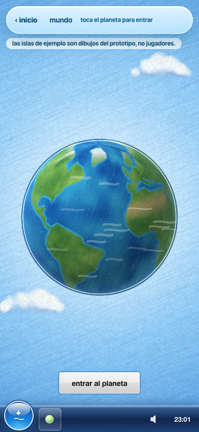 | 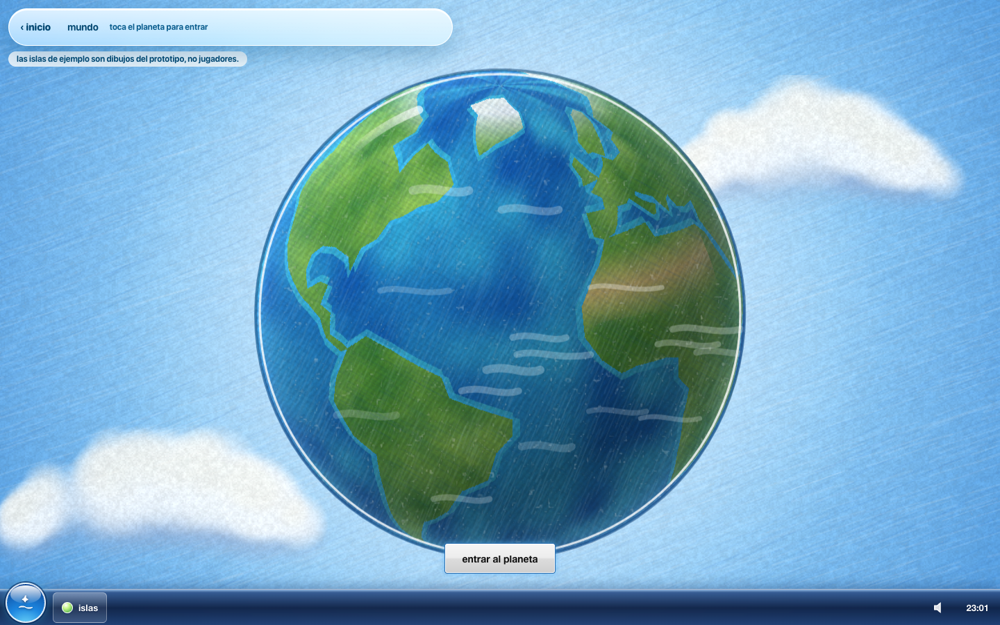 |
| mundo (archipiélago) | 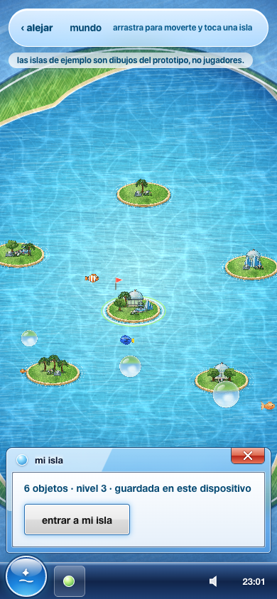 | 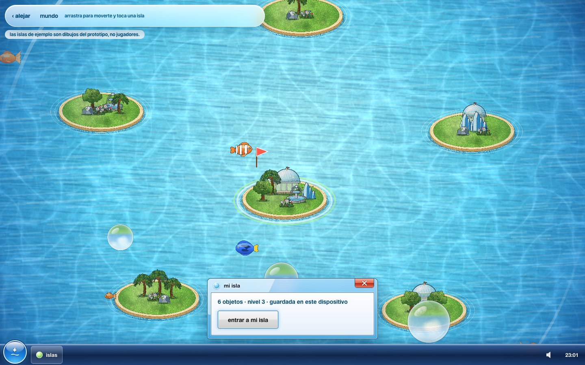 |
| elegir país | 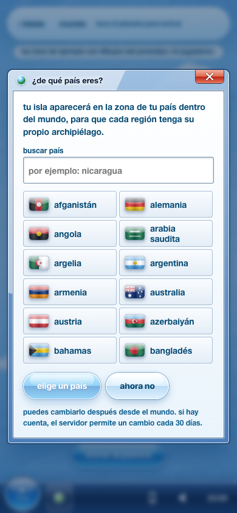 | 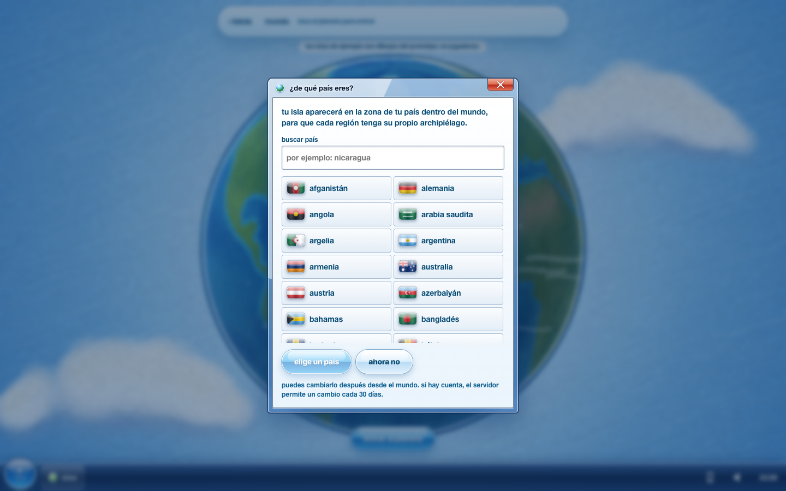 |
| mundo por países | 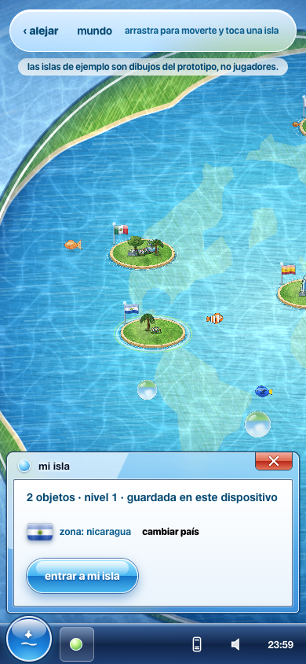 | 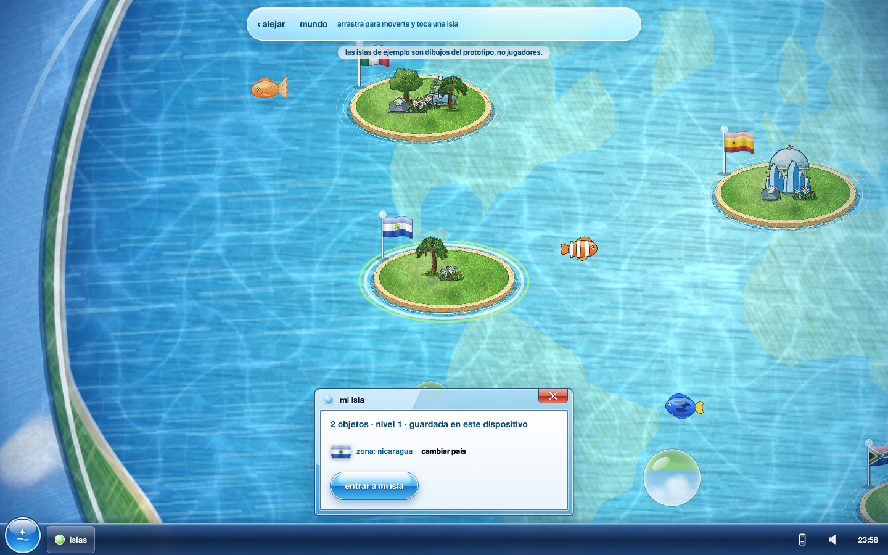 |
| transición al abrir la isla | 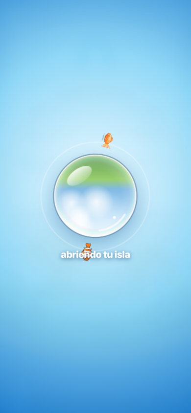 | 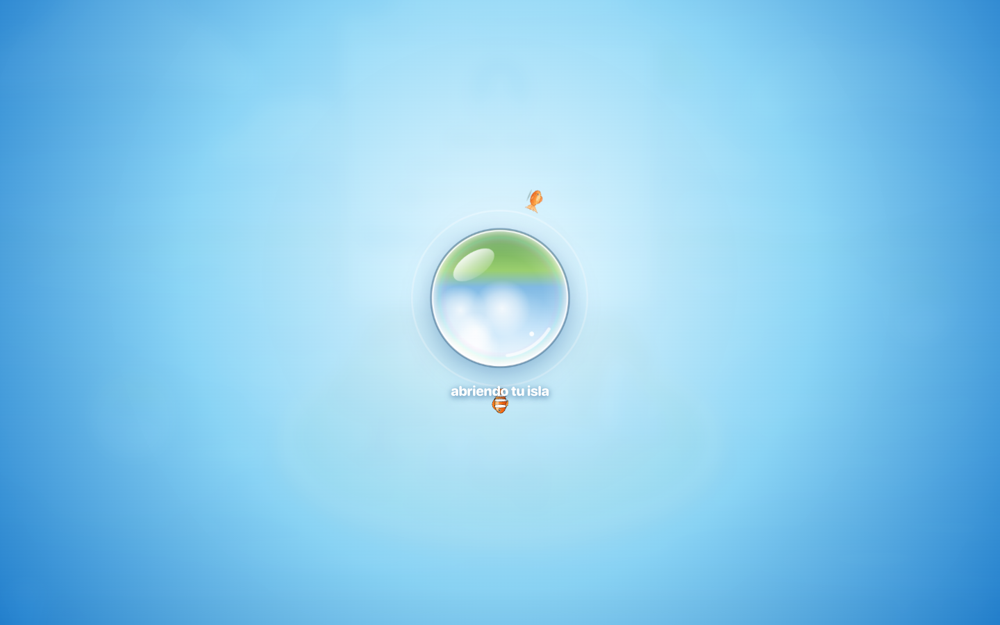 |
| cuenta con sesión | 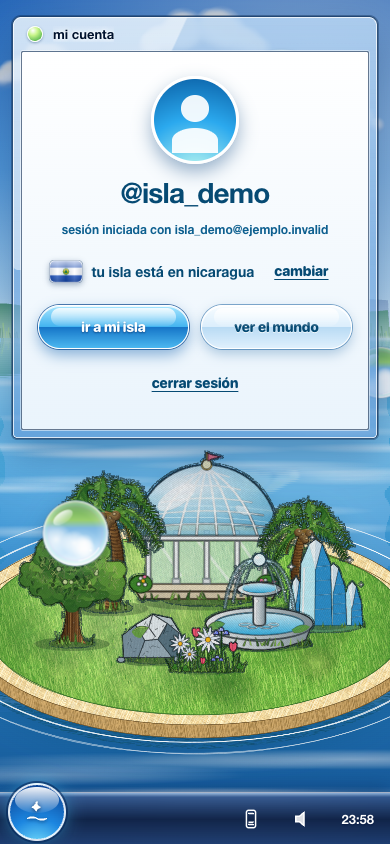 | 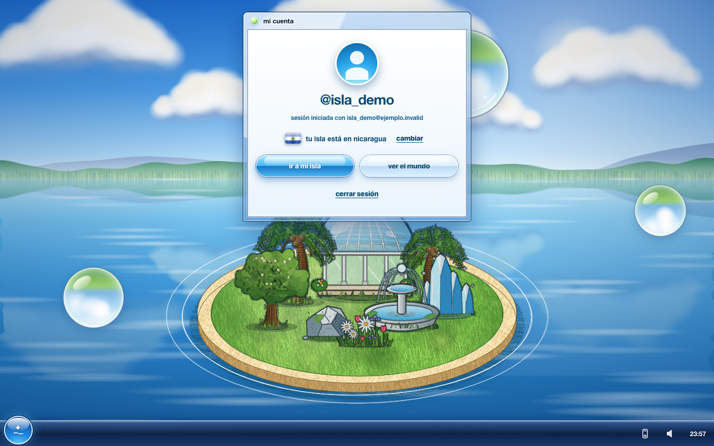 |
| cámara y álbum | 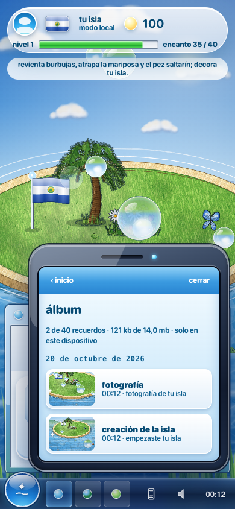 | 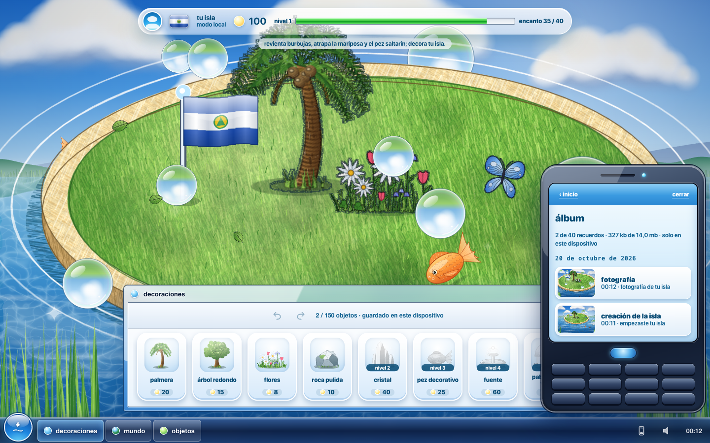 |
| radio en el teléfono | 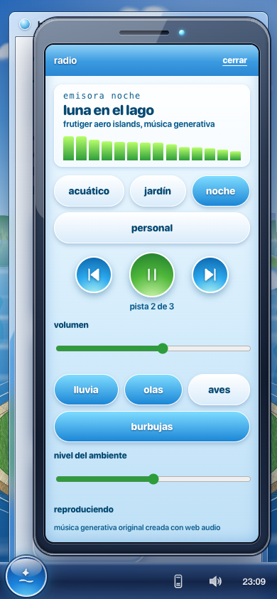 | 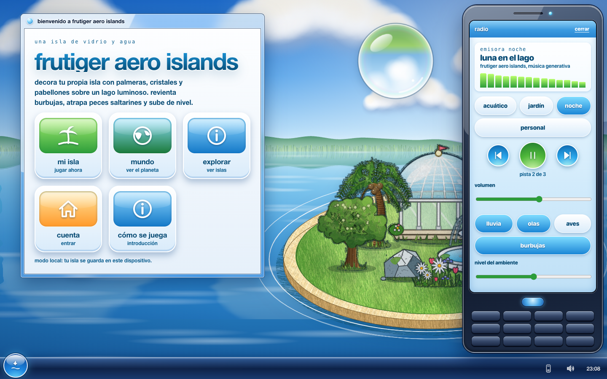 |

la captura de la isla usa un borrador local de muestra (14 objetos) cargado solo para fotografiarla; no son datos de comunidad.

## documentación

- [arquitectura y modelo de datos](docs/ARCHITECTURE.md)
- [paquetes de implementación](docs/tasks/IMPLEMENTATION.md)
- [recursos y autoría](docs/ASSETS.md)
- [radio y teléfono](docs/RADIO.md)
- [auditoría y plan de integración](docs/INTEGRATION_PLAN.md)
- [cámara y álbum](docs/CAMARA_ALBUM.md)
- [país, zonas y banderas](docs/WORLD_COUNTRIES.md)
- [flujos y su lógica](docs/FLUJOS.md)
- [progreso y próxima tarea](DEVELOPMENT_PROGRESS.md)

referencia visual: https://kisnner26.github.io/kisnner26/
