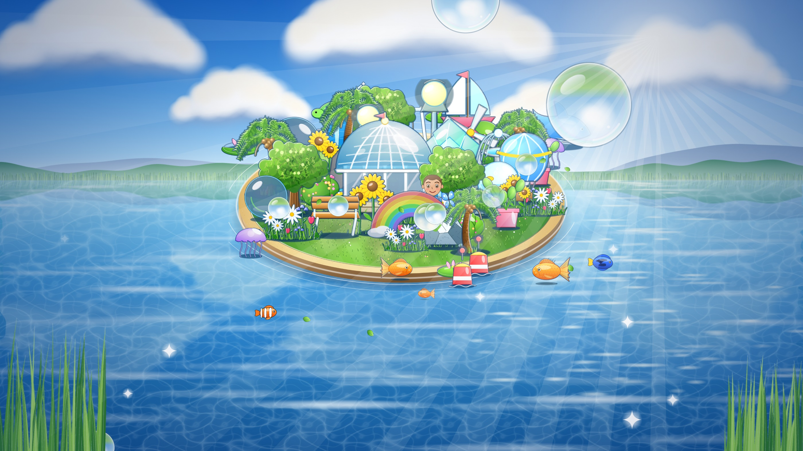
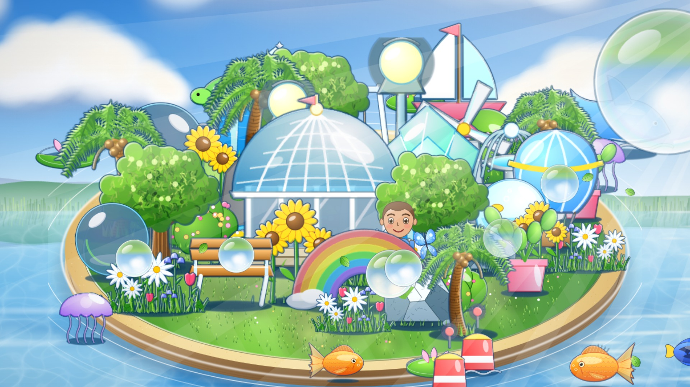
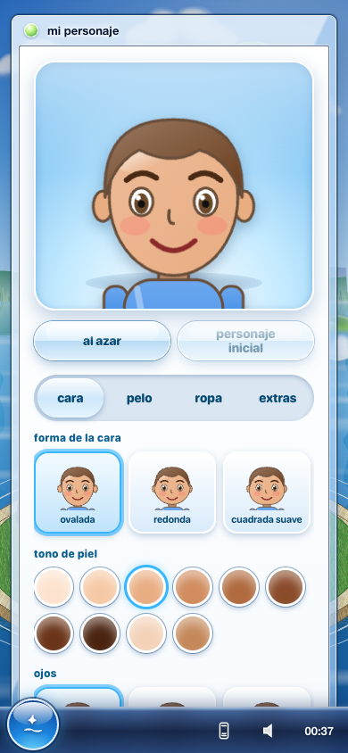
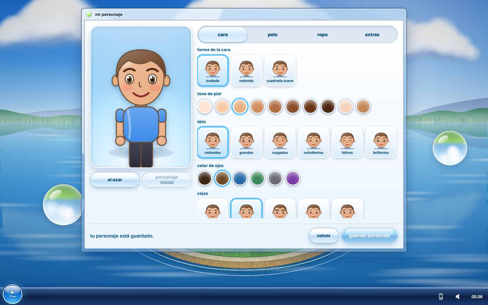
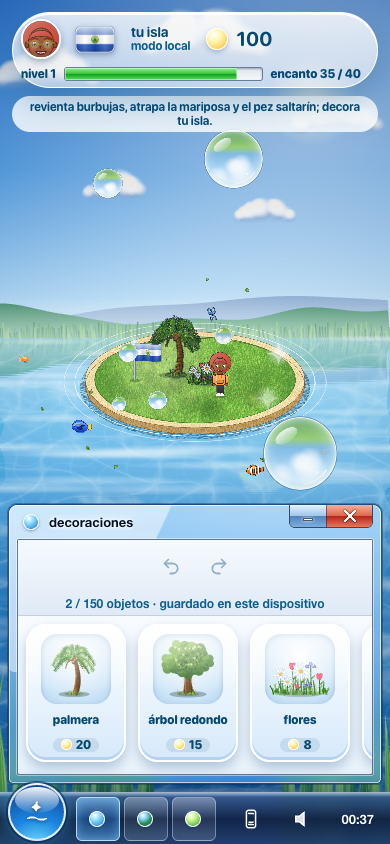
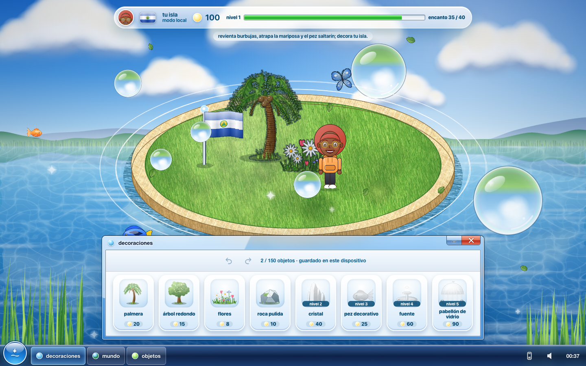

# frutiger aero islands





videojuego de decoración de islas en pleno frutiger aero: lago con reflejos, burbujas de cristal, peces, ventanas estilo windows vista y fichas estilo wii u. estado: beta jugable con cuentas. se juega en https://kisnner26.github.io/frutiger-aero-islands/ y hay que crear una cuenta gratuita (el registro está en la portada); el archipiélago y las islas de otros jugadores viven en supabase.

## qué hay hoy

- **tu isla:** revienta burbujas (las doradas valen más), atrapa la mariposa y el pez que salta para ganar brillos, y con ellos compras palmeras, árboles, flores, rocas, cristales, fuentes, pabellones y peces. el encanto sube con la variedad y la armonía entre objetos cercanos; cada nivel desbloquea decoraciones nuevas. se guarda en la nube y el editor conserva una copia local de respaldo.
- **personaje y país:** editor de personaje y elección de país con su bandera.
- **mundo:** planeta y archipiélago con las islas de otros jugadores, quién está en línea y unas pocas zonas dañadas que la comunidad restaura entre varias personas (energía, reclamar y capturar parcelas; las reglas se validan en el servidor, véase [conquista](docs/CONQUISTA.md)).
- **explorar y visitar** islas de otros jugadores, y un ranking.
- **arcade** con minijuegos, **cámara y álbum**, **misiones e historia**, y la **radio** en el teléfono de la bandeja.
- **reglas y privacidad** de la beta, reportes de jugadores y borrado de cuenta.

límites conocidos: los brillos que dan las burbujas siguen siendo lógica del cliente, así que no se usan para el ranking ni para premios escasos hasta que las recompensas de los minijuegos pasen por el servidor (véase [seguridad y lanzamiento](docs/seguridad-lanzamiento.md)). el progreso detallado y lo pendiente están en [DEVELOPMENT_PROGRESS.md](DEVELOPMENT_PROGRESS.md), que es una bitácora de trabajo y en sus primeras secciones conserva el estado de los primeros paquetes.

## ejecutar

```bash
npm install
npm run dev
```

otros scripts: `npm run typecheck`, `npm run build`, `npm run preview`, `npm test`.

para tener cuentas e islas compartidas hace falta tu propio proyecto de supabase: aplica en orden las migraciones de `supabase/migrations/` y copia `.env.example` a `.env.local` con `VITE_SUPABASE_URL` y `VITE_SUPABASE_PUBLISHABLE_KEY` (solo la clave publicable, nunca la `service_role`; véase [supabase](docs/SUPABASE.md)). sin ellas no hay cuentas ni islas de otros jugadores.

rutas hash: `#/` (inicio), `#/introduccion`, `#/auth` (cuenta) y `#/reglas` son públicas; `#/isla` (tu isla), `#/mundo`, `#/explorar`, `#/island/usuario` (visitar), `#/personaje`, `#/arcade` y `#/ranking` piden sesión. doble clic o doble toque en el fondo restablece la cámara; rueda o pellizco para acercar; esc cancela.

música: radio generativa original en el teléfono de la bandeja (véase [radio](docs/RADIO.md)); no suena hasta que la pulses. la pista personal del autor (`public/audio/soundtrack.mp3`) se publica como emisora opcional por decisión suya; sus derechos no están verificados (véase [recursos](docs/ASSETS.md)).

## capturas reales

| vista | 390 × 844 | 1440 × 900 |
| --- | --- | --- |
| inicio |  |  |
| introducción |  |  |
| isla (juego) |  |  |
| menú de inicio | |  |
| mundo (planeta) |  |  |
| mundo (archipiélago) |  |  |
| personaje |  |  |
| personaje en la isla |  |  |
| elegir país |  |  |
| mundo por países |  |  |
| transición al abrir la isla |  |  |
| cuenta con sesión |  |  |
| cámara y álbum |  |  |
| radio en el teléfono |  |  |

la captura de la isla usa un borrador local de muestra (14 objetos) cargado solo para fotografiarla; no son datos de comunidad.

## documentación

- [arquitectura y modelo de datos](docs/ARCHITECTURE.md)
- [paquetes de implementación](docs/tasks/IMPLEMENTATION.md)
- [recursos y autoría](docs/ASSETS.md)
- [radio y teléfono](docs/RADIO.md)
- [auditoría y plan de integración](docs/INTEGRATION_PLAN.md)
- [personaje](docs/AVATAR.md)
- [cámara y álbum](docs/CAMARA_ALBUM.md)
- [país, zonas y banderas](docs/WORLD_COUNTRIES.md)
- [flujos y su lógica](docs/FLUJOS.md)
- [supabase: cuentas e islas](docs/SUPABASE.md) y [verificar el backend](docs/VERIFICAR_BACKEND.md)
- [seguridad y lanzamiento](docs/seguridad-lanzamiento.md) y [auditoría del 20 de octubre](docs/auditoria-2026-10-20.md)
- [historia, hitos y misiones](docs/HISTORIA.md), [conquista y restauración del mundo](docs/CONQUISTA.md) y [rendimiento](docs/RENDIMIENTO.md)
- [progreso y próxima tarea](DEVELOPMENT_PROGRESS.md)

referencia visual: https://kisnner26.github.io/kisnner26/
